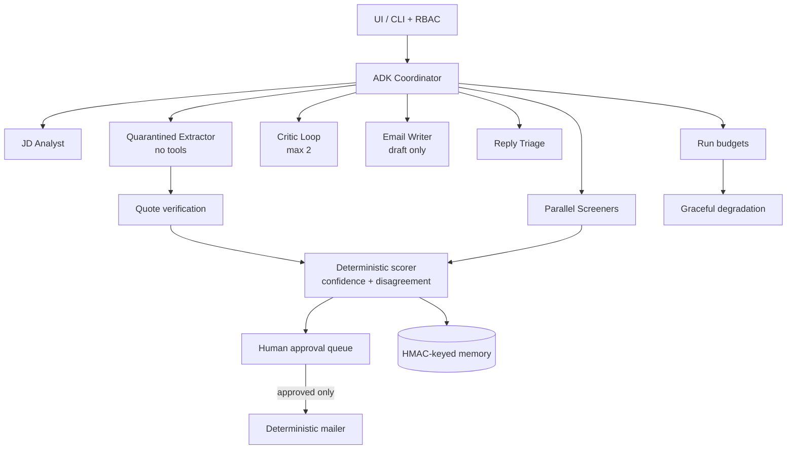

# 🧑‍💼 Smart HR Recruitment — Multi-Agent AI Hiring Pipeline

An end-to-end AI recruitment system built on the **Google Agent Development Kit (ADK)** and **Gemini**. Give it a job description and a pile of resumes (or let it scan your Gmail inbox) and it returns a **ranked shortlist with explainable score cards**, **draft interview invitations that need human approval**, reply triage and a **hiring-insights report**. Every extracted claim is quote-verified, every email is human-approved, and **no model can ever send an email**.


-EA4335?logo=gmail&logoColor=white)


> 🌐 **Live Demo:** [smart-hr-recruitment.onrender.com](https://smart-hr-recruitment.onrender.com/)

[](https://smart-hr-recruitment.onrender.com/)

*Built for the **Google 5-Day AI Agents Intensive** capstone on Kaggle — Track: **Agents for Business**.*

---

## 📋 Table of Contents

- [Project Overview](#-project-overview)
- [Live Demo](#-live-demo)
- [Technology Stack](#-technology-stack)
- [The Agents](#-the-agents)
- [Key Features](#-key-features)
- [Pipeline Architecture](#-pipeline-architecture)
- [Scoring Design](#-scoring-design)
- [Security & Safety Design](#-security--safety-design)
- [Configuration](#-configuration)
- [Dataset](#-dataset)
- [Sample Output](#-sample-output)
- [Testing & Validation](#-testing--validation)
- [System Architecture](#-system-architecture)
- [How to Run](#-how-to-run)
- [Deployment on Render](#-deployment-on-render)
- [Project Structure](#-project-structure)
- [Calibration & Tuning](#-calibration--tuning)
- [Known Limitations](#-known-limitations)
- [Troubleshooting](#-troubleshooting)
- [Real-World Applications](#-real-world-applications)
- [Author](#-author)

---

## 📌 Project Overview

Screening resumes by hand is slow, inconsistent and easy to bias — and naively handing resumes to an LLM is risky: resumes can carry prompt injections, keyword stuffing, hidden text and personal data. Smart HR Recruitment closes those gaps:

1. **Understand the role** — a JD Analyst turns a raw job description (or the position / skills / experience entered in the UI) into structured, explicit requirements.
2. **Extract safely** — a **quarantined extractor** with **no tools** is the only model that sees resume text. Every claim it extracts must carry an **exact supporting quote** or it is dropped.
3. **Score deterministically** — ranking, confidence and recommendations come from a transparent, evidence-weighted Python scorer, not from a model's opinion. Keyword-only resumes are flagged instead of shortlisted.
4. **Keep a human in charge** — invitations are *drafted* by an agent that has no send capability. HR previews, approves, and only then does a deterministic mailer send them.
5. **Close the loop** — candidate replies are read back from Gmail and triaged by intent with a calibrated confidence; the funnel is summarised in an insights report.

### 🎯 Objectives

- Turn a job description + resumes into a **ranked, explainable shortlist** in one run
- Make every decision auditable — each score card shows the **verified quotes** behind it and "why not shortlisted" lists the actual blockers
- **Never trust resume text**: sanitise it, quarantine it, verify every extracted claim, and force human review on injection indicators or hidden PDF text
- Guarantee **human-in-the-loop email** — the draft schema has no send capability and the mailer re-checks the approval flag
- Run **fully offline and deterministic by default**; use Gemini only to improve extraction, and **degrade gracefully** (with a visible banner) when the model fails or a budget runs out
- Protect candidate privacy with **PII masking**, **role-based access control (RBAC)**, an **audit log** and optional **blind screening**
- Ship like a real product: Docker image, Render blueprint, lint gate, PII/secret CI gate and an offline test suite

---

## 🌐 Live Demo

| Service | URL |
|---|---|
| 🖥️ **Web App (Gradio UI)** | [https://smart-hr-recruitment.onrender.com/](https://smart-hr-recruitment.onrender.com/) |
| 💻 **Source Code** | [github.com/Hamza-Asif-ai/Smart-HR-Recruitment](https://github.com/Hamza-Asif-ai/Smart-HR-Recruitment) |

> ⏱️ The app runs on Render's free plan, so it sleeps when idle. The first request after a pause can take about a minute while the server wakes up.

> 🔒 Use **test accounts and sample data only** on the public demo. Connect Gmail with the **read-only** Google sign-in; the Brevo API key is typed into the UI at runtime and is **never written to disk**.

<!--
Optional: add screenshots here once they are saved in docs/screenshots/


-->

---

## 🧰 Technology Stack

| Component | Technology |
|---|---|
| Agent Framework | **Google ADK** (`google-adk`) — coordinator, specialists, parallel screeners, bounded `LoopAgent` critic |
| LLM | **Gemini** (`google-genai`) — model id supplied via `GEMINI_MODEL` (nothing hard-coded, validated at startup) |
| Tool Boundary | **MCP server** (`mcp`) — sandboxed filesystem tools with path-traversal protection |
| UI | **Gradio** — dark / light / system theme with four accent colours |
| Web Layer | FastAPI + Uvicorn routes for the Google OAuth flow (`/auth/google/start`, `/logout`) |
| Inbox & Calendar | Gmail REST API (**read-only**) and Google Calendar **free/busy** via OAuth |
| Email Sending | **Brevo** transactional email HTTP API (HTTPS port 443 — works on hosts that block SMTP) |
| Data & Validation | Pydantic schemas, `pypdf` for PDF resumes, `pandas`, `matplotlib` for charts |
| Memory | SQLite, keyed by `HMAC(email)` — advisory only, raw emails never stored |
| Security | PII masking, RBAC (`admin`, `recruiter`, `hiring_manager`, `viewer`), PBKDF2 password hashes, audit log, login lockout |
| Quality Gates | `pytest` (offline), **Ruff** lint, custom PII/secret scanner in CI |
| CI/CD | GitHub Actions (`ruff` + PII scan + tests) |
| Deployment | **Docker** + **Render** (`render.yaml` blueprint) |
| Language | Python 3.10+ (3.12 recommended) |

---

## 🤖 The Agents

| # | Agent | Input → Output |
|---|---|---|
| 1 | **JD Analyst** | Raw job description → structured requirements |
| 2 | **Quarantined Extractor** | Untrusted resume → quote-verified `CandidateProfile` (**no tools**) |
| 3 | **Screener(s)** | Validated profiles → deterministic scores, confidence, review flags |
| 4 | **Critic** | Screening output → issues; bounded `LoopAgent` (max 2 rounds) |
| 5 | **Email Writer** | Shortlist → **draft-only** invitations in the approval queue |
| 6 | **Reply Triage** | Candidate reply → intent + calibrated confidence |
| 7 | **Insights** | Full funnel → hiring metrics and a markdown report |

### 🧩 Course concepts demonstrated

| Concept | Where it lives |
|---|---|
| **Multi-agent systems (ADK)** | `src/coordinator.py` — coordinator delegates to specialists; shared session state carries validated profiles. The legacy four-stage `SequentialAgent` stays available for compatibility |
| **MCP server integration** | `src/mcp_filesystem_server.py` — `list_resumes`, `read_resume`, `read_job_description`, `save_report` behind a sandbox |
| **Agent Skills** | `src/skills.py` — `resume_parser_skill`, `candidate_scorer_skill`, `email_drafter_skill`, `jd_parser_skill`, `suggest_interview_slots` |
| **Security (PII masking + RBAC)** | `src/security.py` — masks emails, phones and URLs before logging; only `recruiter` / `admin` can view unmasked PII or send invitations |
| **Quarantine + verification** | `src/extractor.py` — exact-quote check on every claim; injection indicators force human review |
| **Human-in-the-loop** | `src/approval.py` — approval queue and mailer gate |
| **Budgets, memory, observability** | `src/budget.py`, `src/memory.py`, `src/tracing.py` |

---

## ✨ Key Features

| Area | What you get |
|---|---|
| 🧾 **Job setup** | Enter position, required skills and experience, or analyse a full job description |
| 📥 **Inbox scanning** | Read-only Gmail OAuth finds applications (PDF / DOCX / text attachments) in your own inbox |
| 🏆 **Ranking** | Match %, confidence, extraction mode, experience (has / needs) and ✓ found / ✗ missing skill chips per candidate |
| 🔍 **Explainability** | Score cards show the verified quotes behind each decision; "why not shortlisted" lists the real blockers |
| 🕶️ **Blind screening** | Optional mode masks names and direct contact details before extraction and scoring |
| ✅ **Approval queue** | Invitations are staged, previewed and sent only after an explicit **Approve & Send** |
| 📅 **Scheduling** | Free slots from Calendar free/busy; invitations carry a standard `.ics` attachment via Brevo |
| ✉️ **Custom invitations** | Default or custom invitation text with placeholders such as `{Candidate Name}`, `{Job Title}`, `{Company Name}`, `{Sender Name}` and `**bold**` |
| 💬 **Reply handling** | Replies to your invitations are read back from Gmail and triaged (confirm / reschedule / decline) with confidence |
| 🗂️ **Workspaces** | Persistent multi-job workspace — save and reload jobs |
| 📤 **Exports** | CSV export with a spreadsheet-formula injection guard |
| 📊 **Insights** | Score chart, top-skills chart, funnel metrics and a markdown report |
| 🎨 **Theming** | Dark / Light / System theme and Indigo / Emerald / Rose / Amber accents |

---

## 🧭 Pipeline Architecture



### Phase 3 run (`run_phase3_pipeline`)

```
Job description + resumes (folder or Gmail inbox)
→ Sanitiser (strip injection patterns, minimise PII)
→ Quarantined Extractor (Gemini, JSON schema, NO tools)
→ Quote verification (claim without an exact quote → dropped)
→ Deterministic scorer (evidence-weighted match %, confidence, review flags)
→ Critic loop (max 2 rounds) → issues surfaced for review
→ Email Writer → DRAFT invitations → Approval queue
→ HR previews → "Approve & Send" → Deterministic mailer (re-checks approved=True) → Brevo API
→ Replies read back from Gmail → Reply Triage → Insights report
```

### Graceful degradation

```
Missing key / model, invalid JSON, or any budget limit hit (calls · tokens · steps · time)
→ switch to deterministic regex extraction
→ show a visible banner
→ results stay available, no further model calls are made
```

---

## 🎯 Scoring Design

A wrong shortlist is the worst mistake a screening tool can make. The scorer is deliberately transparent:

| Rule | What it does |
|---|---|
| **Evidence-weighted skills** | Half of the required-skill score comes from skills *demonstrated in the experience section*, so a resume that only lists keywords is flagged and not shortlisted |
| **Explicit requirements only** | Required skills are read from explicit requirements sections; responsibilities are excluded |
| **Any-of groups** | A group such as AWS / Azure / GCP is satisfied by any one provider |
| **Nice-to-have cap** | Nice-to-have matches contribute at most 10% |
| **Smart experience maths** | Experience date ranges are merged; education dates are ignored |
| **Confidence + disagreement** | When the LLM and regex extraction disagree beyond a threshold, the candidate is flagged for human review |
| **Thresholds** | Shortlist ≥ 75, review ≥ 55 by default (both configurable, validated 0–100, review ≤ shortlist) |
| **Unreadable files** | A scanned PDF with no text layer is flagged for manual review instead of being ranked |

Recommendations: `Strong match - shortlist` · `Possible match - review` · `Possible match - review (keyword stuffing suspected)` · `Weak match - likely reject` · `Unreadable resume - manual review`.

---

## 🛡️ Security & Safety Design

Resumes are **untrusted input**. Several layers protect the pipeline and the candidates:

| Layer | What it does |
|---|---|
| **Prompt-injection defence** | Resume text is sanitised before any LLM use; injection indicators and hidden PDF text force human review |
| **Quarantined extractor** | Only a no-tool model sees minimised resume text; it cannot call tools, read files or send email |
| **Quote verification** | Every extracted claim needs an exact supporting quote or it is discarded |
| **No send capability for models** | The draft schema has no send field; `src/tools.py` exposes no send tool |
| **Approval gate** | Mailer refuses any draft without `approved=True`; the UI requires an explicit **Approve & Send** |
| **PII masking** | `PiiMaskingFilter` masks emails, phones and URLs in logs; truncation uses `safe_preview()` |
| **RBAC** | `admin`, `recruiter`, `hiring_manager`, `viewer`; denied actions are written to an audit log |
| **Authentication** | PBKDF2-hashed passwords, login lockout (default 5 failures / 300 s), JSONL auth audit log |
| **OAuth hygiene** | Read-only scopes (`gmail.readonly`, `calendar.freebusy`); signed, HTTP-only session cookie; server-side state and token stores |
| **Secrets never on disk** | The Brevo API key is entered at runtime; secrets are scrubbed from error messages before they reach the UI |
| **Email safety** | Header-injection checks, address validation, recipient de-duplication and a per-batch cap |
| **Attachment safety** | Size, page, compression-ratio and XML limits on DOCX / PDF attachments |
| **Sandboxed MCP tools** | Path-traversal protection; agents reach the filesystem only through this boundary |
| **Privacy-preserving memory** | SQLite memory keyed by `HMAC(email)`, advisory only; raw candidate emails are never stored |
| **CSV injection guard** | Exports neutralise spreadsheet formulas |
| **CI PII gate** | `tools/check_no_pii.py` blocks real PII and secrets from being committed |

See [**SECURITY.md**](SECURITY.md) for the full policy. If real data was ever committed, deleting it is not enough — purge Git history and rotate exposed credentials.

---

## 🔧 Configuration

All settings are environment variables. Sensible defaults are built in, so the pipeline runs with none of them.

### Core

| Variable | Default | Why |
|---|---|---|
| `HR_DATA_ROOT` | `./data` | Data directory (resumes, job descriptions, output) |
| `HR_USERS` | — | **Required in containers.** UI accounts as `username:role:pbkdf2_hash` separated by `;` (or JSON). Generate a hash: `python -m src.auth --hash-password 'your-password'` |
| `HR_ALLOW_NO_AUTH` | — | Set to `1` for **local development only** — disables login and binds to `127.0.0.1` |
| `SHORTLIST_THRESHOLD` / `REVIEW_THRESHOLD` | `75` / `55` | Match % cut-offs (validated 0–100, review ≤ shortlist) |
| `INTERVIEW_TIMEZONE` | `Asia/Kolkata` | IANA timezone for proposed slots (falls back to UTC if invalid) |
| `BLIND_MODE` | off | `1` starts the app with blind screening enabled |

### Gemini (optional — enables the Phase 3 extractor)

| Variable | Default | Why |
|---|---|---|
| `GOOGLE_API_KEY` / `GEMINI_API_KEY` | — | Free key from [aistudio.google.com](https://aistudio.google.com). Without it the offline deterministic pipeline is used |
| `GEMINI_MODEL` | — | Model id for Phase 3. Nothing is hard-coded; an unavailable id fails startup with a clear error |
| `MAX_LLM_CALLS` / `MAX_TOKENS` / `MAX_SECONDS` | — | Per-run budgets. Exceeding any one degrades to deterministic mode |
| `SKILL_DISAGREEMENT_THRESHOLD` | `0.35` | LLM-vs-regex review threshold (0–1) |
| `REPLY_CONFIDENCE_THRESHOLD` | `0.65` | Reply auto-triage threshold (0–1) |

### Google sign-in (optional — Gmail + Calendar)

| Variable | Why |
|---|---|
| `GOOGLE_CLIENT_ID` / `GOOGLE_CLIENT_SECRET` | OAuth client (type **Web application**) for the read-only Gmail / Calendar scopes |
| `OAUTH_REDIRECT_URI` | Callback URL registered with Google |
| `SESSION_SECRET` / `TOKEN_ENC_KEY` | Sign the session cookie and encrypt stored tokens |
| `GOOGLE_OAUTH_REFRESH_TOKEN` | Deployment-friendly alternative to the local token file |
| `CALENDAR_ID` / `CALENDAR_LOOKAHEAD_DAYS` / `INTERVIEW_SLOT_MINUTES` | Calendar used for free/busy, look-ahead window and slot length |

### Memory, approval and workspace

| Variable | Why |
|---|---|
| `HR_MEMORY_DB` / `HR_MEMORY_HMAC_KEY` | Advisory memory path and a **stable** HMAC key |
| `HR_APPROVAL_QUEUE_MAX_SIZE` | Bounded pending-draft queue |
| `HR_WORKSPACE_FILE` | Saved multi-job workspace JSON |
| `BROWSER_STATE_SECRET` | Enables Gradio `BrowserState`; otherwise the app falls back to in-memory `gr.State` |
| `HR_AUTH_MAX_FAILURES` / `HR_AUTH_LOCKOUT_SECONDS` / `HR_AUTH_AUDIT_LOG` | Login lockout tuning and audit-log path |

> The **Brevo API key is entered in the UI at runtime** and is never written to disk.

---

## 🗃️ Dataset

The repository ships **18 fully synthetic resumes** (15 text + 3 PDF) and **one synthetic job description**. **No real candidate data is included.** The fixtures are built to stress-test the pipeline:

- fresh graduate and junior developer
- career gap and career changer
- **keyword stuffer**
- non-English name and Spanish-language content
- image-only **scanned-style PDF** (no text layer)
- PDF with **white-on-white hidden text**
- resume carrying an **"ignore previous instructions" prompt injection**

All emails use `@example.com` and all phone numbers use the `555` exchange. Rebuild the fixtures with:

```bash
python tools/generate_synthetic_resumes.py
```

Run the PII gate before committing:

```bash
python tools/check_no_pii.py --all
```

---

## 📈 Sample Output

Deterministic baseline on the 18 synthetic resumes (top 8 by match %):

| Rank | Candidate | Source | Match % | Recommendation |
|---|---|---|---|---|
| 1 | Marcus Bell | txt | 93.6 | Strong match - shortlist |
| 2 | Daniel Okafor | txt | 91.1 | Strong match - shortlist |
| 3 | Sofia Martinez | **PDF** | 89.7 | Strong match - shortlist |
| 4 | Jose Alvarez | txt | 88.3 | Strong match - shortlist |
| 5 | Olivia Brown | txt | 82.2 | Strong match - shortlist |
| 6 | Chen Wei | txt | 79.2 | Strong match - shortlist |
| 7 | Nadia Petrova | txt | 79.2 | Strong match - shortlist |
| 8 | Emma Jones | **PDF** | 78.3 | Strong match - shortlist |

**Funnel:** 18 applicants → 10 shortlisted (55.6%) → 10 invitations drafted · average match 64.9%. One scanned-style PDF had no extractable text and is flagged for manual review instead of being ranked.

Artifacts are written to `data/output/` at runtime (git-ignored): `recruitment_insights.md`, plus `ranked_candidates.json`, `interview_emails.json` and `dashboard.png` when generated by the notebook or UI.

---

## 📊 Testing & Validation

| Scenario | Expected behaviour |
|---|---|
| Keyword-stuffed resume | Flagged, **not** shortlisted (skills must be evidenced in experience) |
| Scanned PDF with no text layer | Flagged for **manual review**, not ranked as a candidate |
| White-on-white hidden PDF text | Detected → **human review** forced |
| "Ignore previous instructions" resume | Sanitised and flagged; never followed |
| Extracted claim without an exact quote | **Dropped** by quote verification |
| Draft without `approved=True` | Mailer **refuses** to send (`ApprovalRequiredError`) |
| Role without permission (e.g. `viewer`) | Action denied and written to the audit log |
| Path traversal through the MCP tools | Blocked by the sandbox |
| Missing key / invalid JSON / exhausted budget | Falls back to deterministic extraction with a banner |
| Spreadsheet-formula cell in CSV export | Neutralised |
| Real PII or secrets in the repo | Blocked by `tools/check_no_pii.py` and CI |

Run the offline suite (no API key or internet needed):

```bash
pip install -r requirements-dev.txt
pytest -q
ruff check .
python tools/check_no_pii.py --all
```

CI (`.github/workflows/ci.yml`) runs **ruff + PII scan + tests** on every push.

---

## 🧱 System Architecture

```
┌──────────────────────────────────────────────────────────────────┐
│                  Gradio UI  (app.py, themed, RBAC)                │
│  Job form · Inbox scan · Ranking table · Approval · Replies · Charts│
└───────────────────────────────┬──────────────────────────────────┘
                                │
        ┌───────────────────────┼─────────────────────────┐
        │                       │                         │
  Google OAuth            ADK Coordinator          Approval queue
  (read-only Gmail +      (src/coordinator.py)     (src/approval.py)
   Calendar free/busy)           │                         │
        │            ┌───────────┼───────────┐            │
        │            │           │           │      Deterministic mailer
        │      JD Analyst  Quarantined   Screeners        │
        │                  Extractor     + Critic     Brevo HTTPS API
        │                  (no tools)                      │
        │                      │                      Candidate inbox
        │              Quote verification                  │
        │                      │                           │
        └────────►  Deterministic scorer  ◄───── Reply Triage ◄── Gmail replies
                               │
                    Insights · CSV · Workspace
                               │
                     SQLite memory (HMAC-keyed)
```

---

## 🚀 How to Run

**Requirements:** Python 3.10+ (3.12 recommended). An API key is **optional** — without one the full pipeline runs offline in deterministic mode.

### 1️⃣ Clone and install

Windows (PowerShell):
```powershell
git clone https://github.com/Hamza-Asif-ai/Smart-HR-Recruitment.git
cd Smart-HR-Recruitment
python -m venv venv
venv\Scripts\Activate.ps1
python -m pip install --upgrade pip
pip install -r requirements-dev.txt
```

macOS / Linux:
```bash
git clone https://github.com/Hamza-Asif-ai/Smart-HR-Recruitment.git
cd Smart-HR-Recruitment
python3 -m venv venv
source venv/bin/activate
python -m pip install --upgrade pip
pip install -r requirements-dev.txt
```

> If PowerShell blocks activation: `Set-ExecutionPolicy -Scope CurrentUser -ExecutionPolicy RemoteSigned`, then activate again.

### 2️⃣ Run the pipeline (no API key needed)

Windows (PowerShell):
```powershell
$env:HR_DATA_ROOT="./data"
python -m src.orchestrator
```

macOS / Linux:
```bash
HR_DATA_ROOT=./data python -m src.orchestrator
```

Useful flags:

```bash
python -m src.orchestrator --agents   # ADK-orchestrated path with Gemini (falls back automatically)
python -m src.orchestrator --blind    # mask names / contact details before scoring
```

From Python:

```python
from src.orchestrator import run_pipeline

result = run_pipeline(role="recruiter")                          # deterministic
# result = run_pipeline(role="recruiter", use_agents=True)       # ADK + fallback
# result = run_pipeline(role="recruiter", use_agents=True, blind=True)
```

### 3️⃣ (Optional) Turn on Gemini

```powershell
$env:GOOGLE_API_KEY="your-key-here"
$env:GEMINI_MODEL="your-available-model-id"
```

The quarantined extractor is the only model that receives resume text. If the model fails or a budget is exceeded, the run falls back to regex extraction with a visible banner.

### 4️⃣ Launch the Gradio UI

```bash
python app.py
```

The app **requires authentication**. Set `HR_USERS` (see [Configuration](#-configuration)), or for local development only use `HR_ALLOW_NO_AUTH=1` (binds to `127.0.0.1`).

### 5️⃣ (Optional) Connect Gmail and Calendar

1. Create a Google Cloud OAuth client of type **Web application**.
2. Add your callback as an authorized redirect URI (for local use: `http://localhost:8080/oauth2callback`).
3. Set `GOOGLE_OAUTH_CLIENT_ID` and `GOOGLE_OAUTH_CLIENT_SECRET`, then run:

```bash
python -m src.google_oauth
```

Only `gmail.readonly` and `calendar.freebusy` are requested. The refresh token is stored in the git-ignored `data/output/google_oauth_token.json` (or supply `GOOGLE_OAUTH_REFRESH_TOKEN`).

### 6️⃣ (Optional) Notebook

```bash
pip install jupyter
jupyter notebook notebook/smart_hr_recruitment.ipynb
```

Run it from the **repository root** — the notebook imports the real modules from `src/`. On Kaggle, upload the **whole repository** as a dataset; the `.ipynb` alone is not enough.

### 🖱️ Using the app

1. Enter the **position, required skills and minimum experience** (or load a saved job).
2. **Sign in with Google** (read-only) and **scan your inbox** for applications.
3. Review the **ranked candidates**, score cards and charts.
4. **Select candidates** to invite and preview the drafted emails.
5. Enter the sender email and your **Brevo API key**, then **Approve & Send**.
6. **Check replies** — confirm, reschedule or decline — and export results to CSV.

---

## ☁️ Deployment on Render

The project deploys as a single **Docker Web Service** (`Dockerfile` + `render.yaml`).

### Docker (local test)

```bash
docker build -t smart-hr-recruitment .
docker run -p 10000:10000 -e HR_USERS='admin:admin:<pbkdf2_hash>' smart-hr-recruitment
```

`HR_USERS` is **required** in containers so the app binds publicly with login enabled.

### Render

| Field | Value |
|---|---|
| Runtime | Docker (uses the repo `Dockerfile`) |
| Blueprint | `render.yaml` |
| Port | `10000` |

Set these environment variables in the Render dashboard:

| Variable | Value |
|---|---|
| `HR_USERS` | your `username:role:pbkdf2_hash` entries |
| `GOOGLE_CLIENT_ID` / `GOOGLE_CLIENT_SECRET` | your Google OAuth client |
| `OAUTH_REDIRECT_URI` | `https://<your-service>.onrender.com/<your-callback-path>` — must match the URI registered with Google |
| `SESSION_SECRET` / `TOKEN_ENC_KEY` | long random secrets |
| `GOOGLE_API_KEY` + `GEMINI_MODEL` | optional, enables the Phase 3 extractor |

> **Notes:** Render's free plan **blocks outbound SMTP**, which is why invitations go through the **Brevo HTTPS API**. Verify a single sender email in Brevo (no domain purchase needed). The free plan also sleeps when idle and has a temporary disk, so saved workspaces and advisory memory can reset on restart — use a paid instance with a persistent disk to keep them.

---

## 📁 Project Structure

```
smart-hr-recruitment/
├── README.md
├── SETUP.md                            ← step-by-step setup (Windows first)
├── SECURITY.md                         ← data policy, secrets, history purge
├── requirements.txt                    ← pinned runtime dependencies
├── requirements-dev.txt                ← + pytest + ruff
├── ruff.toml                           ← lint configuration
├── Dockerfile                          ← container image
├── render.yaml                         ← Render deployment blueprint
├── app.py                              ← Gradio UI + Google OAuth routes
├── notebook/
│   └── smart_hr_recruitment.ipynb      ← imports src/, no duplicated code
├── src/
│   ├── security.py                     ← PII masking + RBAC
│   ├── auth.py                         ← users, PBKDF2 hashes, lockout, audit log
│   ├── skills.py                       ← reusable Agent Skills
│   ├── sanitize.py                     ← prompt-injection defence
│   ├── mcp_filesystem_server.py        ← sandboxed MCP file tools
│   ├── coordinator.py                  ← Phase 3 ADK coordinator + specialists
│   ├── extractor.py                    ← quarantined extraction + quote checks
│   ├── models.py                       ← Pydantic schemas
│   ├── scoring.py                      ← deterministic score + confidence
│   ├── guardrails.py                   ← ADK callbacks + reply triage
│   ├── tools.py                        ← role-bound tools (no send tool)
│   ├── approval.py                     ← human approval queue + mailer gate
│   ├── budget.py                       ← per-run budgets + degradation
│   ├── memory.py                       ← HMAC-keyed advisory SQLite memory
│   ├── google_oauth.py                 ← OAuth consent, refresh, token store
│   ├── gmail_api.py                    ← read-only Gmail REST client
│   ├── calendar_api.py                 ← Calendar free/busy + .ics builder
│   ├── scorecard.py                    ← evidence cards + rejection reasons
│   ├── workspace.py                    ← persistent multi-job workspace
│   ├── exporters.py                    ← CSV export with injection guard
│   ├── agents.py                       ← legacy four-stage ADK pipeline
│   ├── adk_stages.py                   ← deterministic ADK stage tools
│   ├── phase3_runner.py                ← Phase 3 runner + model status
│   ├── orchestrator.py                 ← deterministic + Phase 3 runners
│   ├── config.py                       ← env-driven thresholds + timezone
│   ├── runtime.py                      ← per-run context + concurrency gate
│   └── tracing.py                      ← bounded masked trace recorder
├── ui/                                 ← theme.css, theme.js, theme-head.js
├── data/
│   ├── job_descriptions/               ← one synthetic JD
│   └── resumes/                        ← 18 synthetic resumes (15 txt + 3 PDF)
├── tools/
│   ├── generate_synthetic_resumes.py   ← rebuild the fixtures
│   └── check_no_pii.py                 ← CI PII / secret gate
├── docs/ARCHITECTURE.md                ← trust boundaries, failure modes, diagram
├── tests/                              ← offline pytest suite
└── .github/workflows/ci.yml            ← ruff + PII scan + tests
```

`data/output/` is generated at runtime and git-ignored.

---

## 📐 Calibration & Tuning

- **Too many / too few shortlisted** — adjust `SHORTLIST_THRESHOLD` and `REVIEW_THRESHOLD` (review must not exceed shortlist).
- **Too many "human review" flags** — raise `SKILL_DISAGREEMENT_THRESHOLD`; lower it to be stricter about LLM-vs-regex disagreement.
- **Replies need manual checking too often** — tune `REPLY_CONFIDENCE_THRESHOLD`.
- **Model runs hit the budget** — raise `MAX_LLM_CALLS`, `MAX_TOKENS` or `MAX_SECONDS`.
- **Interview slots in the wrong timezone** — set `INTERVIEW_TIMEZONE` (IANA name, e.g. `Asia/Karachi`).
- **Different slot length or look-ahead** — set `INTERVIEW_SLOT_MINUTES` and `CALENDAR_LOOKAHEAD_DAYS`.
- **Use your own test data** — replace the files in `data/` or point `HR_DATA_ROOT` elsewhere.
- **Dark / light colours** — all UI colours live in `ui/theme.css`.

---

## 🚧 Known Limitations

- **Decision support, not a decision maker.** Scores and recommendations are aids for a human recruiter; always review shortlists, especially anything flagged for review.
- **Resume parsing is imperfect.** Unusual layouts, image-only PDFs and non-English resumes may be extracted poorly; unreadable files are flagged for manual review.
- **Synthetic benchmark.** The sample results come from 18 synthetic resumes, not a validated real-world dataset.
- **Gemini is optional but not required for quality claims.** Without a key the app uses deterministic regex extraction.
- **Read-only inbox access.** The app reads applications and replies through Gmail but never sends from your mailbox; invitations go through Brevo.
- **Brevo sender verification.** The sender email must be verified in Brevo before invitations can be delivered.
- **Free-tier hosting.** Cold starts of about a minute, and a temporary disk that can reset saved workspaces and memory.
- **Google sign-in for other users.** While the Google OAuth app is in testing mode, only listed test users can connect their Gmail.
- **Text-based scoring.** There is no video / interview assessment and no bias audit beyond the optional blind-screening mode.

---

## 🩺 Troubleshooting

| Problem | Solution |
|---|---|
| `python` not recognised (Windows) | Reinstall Python with **"Add python.exe to PATH"** ticked, or use `py` |
| `Activate.ps1 cannot be loaded` | `Set-ExecutionPolicy -Scope CurrentUser -ExecutionPolicy RemoteSigned`, then activate again |
| `ModuleNotFoundError` | Activate the venv (prompt shows `(venv)`) before running |
| Pipeline can't find data | Set `HR_DATA_ROOT=./data` in the **same** terminal session |
| App refuses to start | Set `HR_USERS`, or use `HR_ALLOW_NO_AUTH=1` for local development only |
| "Google sign-in is disabled: set …" | Set `GOOGLE_CLIENT_ID`, `GOOGLE_CLIENT_SECRET`, `OAUTH_REDIRECT_URI`, `SESSION_SECRET` and `TOKEN_ENC_KEY` |
| Gmail shows "not connected" | Click **Sign in with Google** first; the session cookie may have expired |
| Google "access blocked" screen | Add your account as a test user in the Google Cloud OAuth consent screen |
| Startup error about `GEMINI_MODEL` | The model id is invalid or unavailable — fix it or remove the Gemini variables to use offline mode |
| Banner says deterministic fallback | Missing key, invalid JSON or a budget limit was reached — results are still valid |
| Emails fail with a 4xx from Brevo | Verify the sender email in Brevo and re-check the API key |
| SMTP errors on Render | Free-tier Render blocks SMTP — use the built-in Brevo API path |
| "The server is busy" | The send queue is full; try again in a moment |
| Saved jobs disappeared on Render | Free instances use a temporary disk — use a persistent disk or paid plan |
| First request is very slow on Render | The free instance was asleep; it needs about a minute to wake |
| Env var "lost" in a new terminal | Environment variables and venvs are session-specific — set them again |

---

## 🌍 Real-World Applications

- **HR teams and recruiters** — fast, consistent first-pass screening with an audit trail
- **Startups without an ATS** — a lightweight pipeline that works straight from a Gmail inbox
- **Staffing agencies** — rank many candidates against many roles using saved workspaces
- **Campus and internship drives** — screen large application batches with blind mode
- **Privacy-conscious hiring** — PII masking, HMAC-keyed memory and human approval by design
- **AI-agent developers** — a reference for Google ADK + MCP with quarantine, guardrails, budgets and graceful degradation

---

## 👨‍💻 Author

**Hamza Asif**  
BS Artificial Intelligence — DUET, Karachi

[](https://github.com/Hamza-Asif-ai)
[](https://linkedin.com/in/hamzaasif-ai)

---

*Built for the Google 5-Day AI Agents Intensive capstone — Track: Agents for Business.*
