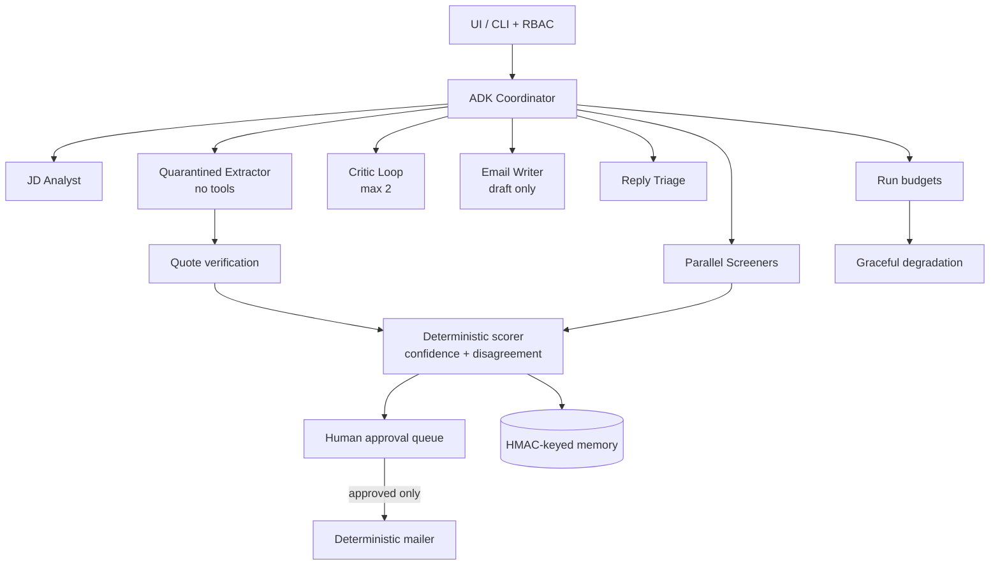

# Smart HR Recruitment - Multi-Agent System (Google ADK)

**Google AI Agents Capstone Project · Track: _Agents for Business_**

An end-to-end recruitment pipeline built on the **Google Agent Development Kit
(ADK)**. Feed it a job description and a folder of resumes; get back a ranked
shortlist, draft interview invitations that require human approval, and a
hiring-insights report.

The default path is **offline and deterministic**. Phase 3 adds a real ADK
coordinator with a quarantined extractor, parallel screeners, a critic loop,
draft-only email writer, reply triage, per-run budgets, and an approval queue.
With a Gemini key, `run_phase3_pipeline()` performs quote-verified extraction
before deterministic scoring. Any model failure or budget exhaustion degrades
to the regex path with a visible banner. **No model can send email.**

Phase 5 adds read-only Gmail OAuth, Google Calendar free/busy slot proposals
with `.ics` attachments, explainable candidate score cards, persistent multi-job
workspaces, and CSV exports. Deployment artifacts (`Dockerfile`, `render.yaml`)
and a ruff lint gate are included.

---

## What it does

| # | Agent | Input → Output |
|---|-------|----------------|
| 1 | **JD Analyst** | Raw job description → structured requirements |
| 2 | **Quarantined Extractor** | Untrusted resume → quote-verified `CandidateProfile` (no tools) |
| 3 | **Screener(s)** | Validated profiles → deterministic scores, confidence, review flags |
| 4 | **Critic** | Screening output → issues; bounded `LoopAgent` (max 2) |
| 5 | **Email Writer** | Shortlist → draft-only invitations in the approval queue |
| 6 | **Reply Triage** | Candidate reply → intent + calibrated confidence |
| 7 | **Insights** | Full funnel → hiring metrics and a markdown report |

---

## Concepts demonstrated

1. **Multi-agent systems with ADK** — the Phase 3 coordinator delegates to a
   no-tool extractor, JD analyst, parallel screeners, a bounded critic loop,
   draft-only email writer, and reply triage. Shared session state carries
   validated profiles and summaries. The legacy four-stage `SequentialAgent`
   remains available for compatibility; ranking and drafting stay in Python.

2. **MCP Server integration** — `src/mcp_filesystem_server.py` exposes
   *sandboxed* file tools (`list_resumes`, `read_resume`,
   `read_job_description`, `save_report`) with path-traversal protection.
   Agents reach the filesystem only through this boundary.

3. **Agent Skills** — reusable, testable tools. `resume_parser_skill`,
   `candidate_scorer_skill`, and `email_drafter_skill` (plus `jd_parser_skill`
   and `suggest_interview_slots`) do the work; `adk_stages.py` exposes the four
   pipeline stages as ADK `FunctionTool`s.

4. **Security / PII masking + RBAC** — `src/security.py` masks emails, phones,
   and URLs before logging, and enforces role-based access control so only
   `recruiter`/`admin` roles can view unmasked PII or send invitations. Every
   gated action is written to an audit log.

5. **Quarantine + verification** — only the no-tool extractor sees minimized
   resume text. Every extracted claim must include an exact supporting quote or
   it is dropped. Injection indicators and hidden PDF text force human review.

6. **Human-in-the-loop email** — the draft schema has no send capability. The UI
   stages drafts, shows a preview, and sends only after an explicit approval;
   the deterministic mailer re-checks the approval flag.

7. **Budgets, memory, observability** — per-run call/token/step/time budgets
   degrade to deterministic mode, SQLite memory is keyed by `HMAC(email)` and is
   advisory only, and trace spans are bounded and PII-masked.

8. **Explainability and scheduling** — score cards surface the verified quotes
   behind each decision, "why not shortlisted" lists the actual blockers, free
   slots come from Calendar free/busy, and invitations carry a standard `.ics`
   file attached through Brevo.

---

## Architecture



See **[docs/ARCHITECTURE.md](docs/ARCHITECTURE.md)** for trust boundaries,
callbacks, budgets, failure modes, and environment variables.

## Project structure

```text
smart-hr-recruitment/
├── README.md
├── SETUP.md
├── SECURITY.md                         ← data policy, secrets, history purge
├── requirements.txt                    ← pinned runtime dependencies
├── requirements-dev.txt                ← + pytest + ruff
├── ruff.toml                           ← lint configuration
├── Dockerfile                          ← container image
├── render.yaml                         ← Render deployment blueprint
├── app.py                              ← Gradio demo UI
├── notebook/
│   └── smart_hr_recruitment.ipynb      ← imports src/, no duplicated code
├── src/
│   ├── security.py                     ← PII masking + RBAC
│   ├── skills.py                       ← reusable Agent Skills
│   ├── sanitize.py                     ← prompt-injection defense
│   ├── mcp_filesystem_server.py        ← sandboxed MCP file tools
│   ├── coordinator.py                  ← Phase 3 ADK coordinator + specialists
│   ├── extractor.py                    ← quarantined extraction + quote checks
│   ├── models.py                       ← pydantic schemas
│   ├── scoring.py                      ← deterministic score + confidence
│   ├── guardrails.py                   ← ADK callbacks + reply triage
│   ├── tools.py                        ← role-bound tools (no send tool)
│   ├── approval.py                     ← human approval queue + mailer gate
│   ├── budget.py                       ← per-run budgets + degradation
│   ├── memory.py                       ← HMAC-keyed advisory SQLite memory
│   ├── google_oauth.py                 ← OAuth consent, refresh, token store
│   ├── gmail_api.py                    ← read-only Gmail REST client
│   ├── calendar_api.py                 ← Calendar free/busy + `.ics` builder
│   ├── scorecard.py                    ← evidence cards + rejection reasons
│   ├── workspace.py                    ← persistent multi-job workspace
│   ├── exporters.py                    ← CSV export with injection guard
│   ├── agents.py                       ← legacy four-stage ADK pipeline
│   ├── adk_stages.py                   ← deterministic ADK stage tools
│   ├── orchestrator.py                 ← deterministic + Phase 3 runners
│   ├── config.py                       ← env-driven thresholds + timezone
│   ├── runtime.py                      ← per-run context + concurrency gate
│   └── tracing.py                      ← bounded masked trace recorder
├── data/
│   ├── job_descriptions/               ← one synthetic JD
│   └── resumes/                        ← 18 synthetic resumes (15 txt + 3 PDF)
├── tools/
│   ├── generate_synthetic_resumes.py   ← rebuild the fixtures
│   └── check_no_pii.py                 ← CI PII/secret gate
├── docs/ARCHITECTURE.md                ← Phase 3 design + Mermaid diagram
├── tests/                              ← offline pytest suite
└── .github/workflows/ci.yml            ← ruff + PII scan + tests
```

`data/output/` is generated at runtime and gitignored.

---

## How to run

### Local pipeline (no API key needed)

```bash
python -m venv venv
# Windows: venv\Scripts\activate
source venv/bin/activate
pip install -r requirements-dev.txt

HR_DATA_ROOT=./data python -m src.orchestrator
# With Gemini, try the ADK-orchestrated path (falls back automatically):
HR_DATA_ROOT=./data python -m src.orchestrator --agents
# Enable blind screening (names/contact details masked before scoring):
HR_DATA_ROOT=./data python -m src.orchestrator --blind
```

Or from Python:

```python
from src.orchestrator import run_pipeline
result = run_pipeline(role="recruiter")                 # deterministic
# result = run_pipeline(role="recruiter", use_agents=True)  # ADK + fallback
# result = run_pipeline(role="recruiter", use_agents=True, blind=True)
```

### Notebook

The notebook **imports the real modules from `src/`** and uses the shared
synthetic dataset. It no longer writes duplicate source files.

```bash
pip install -r requirements-dev.txt
jupyter notebook notebook/smart_hr_recruitment.ipynb
```

Run it from the repository root (the first cell locates the root automatically).
For Kaggle, upload the **whole repository** as a dataset or clone it into the
notebook session; uploading only the `.ipynb` is not enough because it imports
`src/`.

### Gradio UI

```bash
python app.py
```

The app requires UI authentication. Configure `HR_USERS` with
`username:role:pbkdf2_hash` entries separated by `;` (or JSON), and generate
hashes with `python -m src.auth --hash-password 'your-password'`. For local
development only, `HR_ALLOW_NO_AUTH=1` disables login and binds the server to
`127.0.0.1`. See [SECURITY.md](SECURITY.md) for roles and audit settings.

Connect Gmail/Calendar once with the read-only OAuth flow:

```bash
python -m src.google_oauth
```

The refresh token is stored in the git-ignored `data/output/google_oauth_token.json`
unless you supply `GOOGLE_OAUTH_REFRESH_TOKEN`.

### Docker and Render

```bash
docker build -t smart-hr-recruitment .
docker run -p 10000:10000 -e HR_USERS='...' smart-hr-recruitment
```

`HR_USERS` is required in containers so the app binds publicly with login
enabled. `render.yaml` provisions the same image on Render; set the OAuth and
Gemini secrets in the Render dashboard.

Optional environment variables:

- `BROWSER_STATE_SECRET` — enables Gradio `BrowserState`; without it the app
  falls back to in-memory `gr.State`.
- `GOOGLE_API_KEY` / `GEMINI_API_KEY` — enables the Phase 3 extractor.
- `GEMINI_MODEL` — required model id for Phase 3; validated at startup.
- `MAX_LLM_CALLS` / `MAX_TOKENS` / `MAX_SECONDS` — per-run budgets.
- `SKILL_DISAGREEMENT_THRESHOLD` / `REPLY_CONFIDENCE_THRESHOLD` — review
  thresholds (0–1).
- `HR_MEMORY_DB` / `HR_MEMORY_HMAC_KEY` — advisory memory path and key.
- `HR_APPROVAL_QUEUE_MAX_SIZE` — bounded pending-draft queue.
- `HR_DATA_ROOT` — points at a different data directory.
- `BLIND_MODE=1` — starts the app with blind screening enabled (names and
  direct contact details are masked before extraction/scoring).
- `SHORTLIST_THRESHOLD` / `REVIEW_THRESHOLD` — shortlist and review cut-offs
  (default 75 / 55, validated 0–100 and review ≤ shortlist).
- `INTERVIEW_TIMEZONE` — IANA timezone for proposed slots (default
  `Asia/Kolkata`; falls back to UTC if invalid).
- `GOOGLE_OAUTH_CLIENT_ID` / `GOOGLE_OAUTH_CLIENT_SECRET` — Google OAuth client
  for the read-only Gmail and Calendar scopes.
- `GOOGLE_OAUTH_REDIRECT_URI` — callback URL registered with Google.
- `GOOGLE_OAUTH_REFRESH_TOKEN` — deployment-friendly alternative to the local
  token file.
- `CALENDAR_ID` / `CALENDAR_LOOKAHEAD_DAYS` / `INTERVIEW_SLOT_MINUTES` —
  calendar used for free/busy, lookahead window, and slot length.
- `HR_WORKSPACE_FILE` — path to the saved multi-job workspace JSON.

The Brevo API key is entered in the UI at runtime and is never written to disk.
Use test accounts only.

---

## Sample output

Current deterministic baseline on the 18 synthetic resumes (top 8 by match %):

| Rank | Candidate | Source | Match % | Recommendation |
|------|-----------|--------|---------|----------------|
| 1 | Marcus Bell | txt | 93.6 | Strong match - shortlist |
| 2 | Daniel Okafor | txt | 91.1 | Strong match - shortlist |
| 3 | Sofia Martinez | **PDF** | 89.7 | Strong match - shortlist |
| 4 | Jose Alvarez | txt | 88.3 | Strong match - shortlist |
| 5 | Olivia Brown | txt | 82.2 | Strong match - shortlist |
| 6 | Chen Wei | txt | 79.2 | Strong match - shortlist |
| 7 | Nadia Petrova | txt | 79.2 | Strong match - shortlist |
| 8 | Emma Jones | **PDF** | 78.3 | Strong match - shortlist |

Funnel: 18 applicants → 10 shortlisted (55.6%) → 10 invitations drafted; average
match 64.9%. One scanned-style PDF had no extractable text and is flagged for
manual review instead of being ranked as a candidate.

> Scoring is evidence-weighted: half of the required-skill score comes from
> skills demonstrated in the experience section, so a resume that only lists
> keywords is flagged and does not get shortlisted. Required skills are read
> only from explicit requirements sections (responsibilities are excluded), and
> an any-of group such as AWS/Azure/GCP is satisfied by any one provider.
> Nice-to-have matches contribute at most 10%. Experience ranges are merged and
> education dates are ignored.

Artifacts are written to `data/output/` at runtime:
`recruitment_insights.md` (and JSON/dashboard artifacts when generated by the
notebook or UI). This directory is gitignored.

---

## Dataset

The repository ships **18 fully synthetic resumes** plus one synthetic job
description. No real candidate data is included. The fixtures cover:

- fresh graduate and junior developer
- career gap and career changer
- keyword stuffer
- non-English name and Spanish-language content
- image-only **scanned-style PDF** (no text layer)
- PDF with **white-on-white hidden text**
- resume carrying an **"ignore previous instructions"** prompt injection

All emails use `@example.com`; all phone numbers use the `555` exchange. Rebuild
the fixtures with:

```bash
python tools/generate_synthetic_resumes.py
```

Run the PII gate before committing:

```bash
python tools/check_no_pii.py --all
```

---

## Security

See **[SECURITY.md](SECURITY.md)** for the full policy. Highlights:

- Real PII and secrets are blocked by `tools/check_no_pii.py` and CI.
- Logs pass through `PiiMaskingFilter`; truncation uses `safe_preview()`.
- RBAC: `admin`, `recruiter`, `hiring_manager`, `viewer`.
- Resume text is sanitised before LLM use.
- If real data was ever committed, deleting it is not enough — purge Git
  history and rotate exposed credentials.

---

## Agentic architecture

- **Phase 3 (`run_phase3_pipeline`)** — the coordinator delegates to a
  no-tool extractor, JD analyst, parallel screeners, critic loop, draft-only
  email writer, and reply triage. Extraction uses Gemini with a JSON schema and
  exact-quote verification; scoring, confidence, ranking, and drafting are
  deterministic. No model tool can send email.
- **Degradation** — missing key/model, invalid JSON, or any budget limit
  switches to deterministic regex extraction and shows a banner. Results remain
  available and no further model calls are made.
- **Approval** — invitations are staged in `src/approval.py`; the UI previews
  them and requires an explicit **Approve & Send**. The mailer refuses any draft
  without `approved=True`.
- **Legacy ADK path** — `run_pipeline(use_agents=True)` /
  `python -m src.orchestrator --agents` retains the four-stage
  `SequentialAgent` for compatibility, with result validation and fallback.

See [docs/ARCHITECTURE.md](docs/ARCHITECTURE.md) for the full trust-boundary
diagram and failure modes.

## Tech stack

`google-adk` · `google-genai` (Gemini) · `mcp` · `pandas` · `matplotlib` ·
`pypdf` · `gradio` · `pytest`

*Built for the Google AI Agents Capstone - "Agents for Business" track.*
